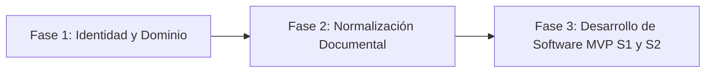

# Hoja de Ruta y Bitácora de Reestructuración – NewBit
**Curso:** Ingeniería de Software II (UNS, 2026-II)  
**Equipo:** Grupo D3 (Albert Chumacero, Anthony Lopez, Luis Salazar)  
**Fecha de inicio de reestructuración:** 17/10/2026  
**Última actualización:** 17/10/2026  

---

## 1. Diagnóstico y Objetivo de la Reestructuración

### 1.1. Situación Actual
El proyecto **NewBit** (`PY-NB-001`) sufrió un pivote abrupto desde el proyecto previo (*VIGIA Industrial / SIDERPERU*) hacia la investigación *Unsafe-Net* (Önal y Dandıl, 2024). Aunque se generaron documentos en las semanas 2 a 5, el proyecto presenta severas incoherencias que impiden avanzar con el desarrollo real:
1. **Disonancia de dominio:** Se nombra a SIDERPERU (siderúrgica pesada) como beneficiario, pero se usa un dataset de una fábrica metalmecánica/plástica de Turquía (Kafaoğlu) con conductas que no representan el riesgo de acería.
2. **Ruptura de trazabilidad:** Las historias de usuario activas en el Backlog usan roles de laboratorio ("investigador", "evaluador") en lugar de los perfiles de usuario aprobados en el documento de Roles FGAP030 (SST, Supervisor, Monitoreo).
3. **Ambigüedad de alcance técnico:** El marketing plantea "cámaras en vivo y sensores inteligentes", mientras que el alcance técnico real es un prototipo web que procesa videos grabados (.mp4 / .avi).
4. **Desfase en planificación:** HU11 figura en Sprint 4 en unos documentos y en Sprint 2 en otros; no existe un repositorio de código base funcional para el Sprint 1 y 2.

### 1.2. Meta del Desarrollador (Luis Salazar)
Normalizar la documentación,Backlog y arquitectura para que el desarrollo del MVP (hasta la mitad del plan original: Sprints 1 y 2 – Ingesta, procesamiento de video, detección YOLO y panel web de visualización) sea **técnicamente viable, consistente, académicamente defendible y evaluable por el docente**.

---

## 2. Bitácora de Decisiones Tomadas

| # | Fecha | Tema / Área | Decisión Adoptada | Impacto en Entregables |
|---|---|---|---|---|
| D-00 | 17/10/2026 | Gobernanza | Creación de este documento central de seguimiento | Guía maestra de normalización del repositorio |
| D-01 | 17/10/2026 | Título y Dominio | **Aprobada Opción 1:** "PY-NB-001 – Sistema web con Visión Artificial para la detección de actos inseguros en áreas operativas de manufactura metalmecánica" (Nombre comercial: NewBit). Entorno: Talleres y naves de manufactura/metalmecánica. | Normalizará: FGAP010 (Acta), FGAP030 (Roles), EGAP015 (Justificación), PPT Presentación y Backlog. Se justifica el uso directo del dataset de Kafaoğlu. |
| D-02 | 17/10/2026 | Roles y Backlog | **Mapeo de 12 HU a Perfiles Reales (FGAP030):** Eliminados roles genéricos ("investigador", "evaluador"). Sprint 1: HU01 (Jorge/TI), HU02 (Jorge/TI), HU03 (Mariana/SST). Sprint 2: HU04 (Jorge/TI), HU05 (Mariana/SST), HU06 (Mariana/SST), HU11 (Jorge/TI). Sprint 3: HU07 (Mariana/SST), HU08 (Mariana/SST). Sprint 4: HU09 (Lucía/Monitoreo), HU10 (Lucía/Monitoreo), HU12 (Ricardo/Gerente - Jorge/TI). | Reemplazará el FGAP040 del equipo, armonizará Tablero Kanban, Puño de Cinco y MoSCoW. HU11 queda fijada en Sprint 2 y HU08 incluye tipificación. |
| D-03 | 17/10/2026 | Arquitectura y Stack | **Stack 100% Python y Detector Moderno:** Backend y UI con FastAPI + Jinja2/Tailwind + OpenCV. Detector: YOLOv8n (`ultralytics`) justificado académicamente como modernización del baseline espacial. Estructura: `proyecto-newbit/app/` (web) y `proyecto-newbit/ml/` (visión). Alcance MVP: Sprints 1 y 2 (15 puntos). | Fija el alcance de código para Luis. Elimina fricción de compilación Darknet/C y desacoplamiento innecesario. |
| D-04 | 17/10/2026 | Estrategia Documental | **Plan de Normalización en 4 Bloques:** Bloque 1 (Depuración de duplicados 26 HU $\rightarrow$ `descartado/`), Bloque 2 (Alineación en cascada de Acta FGAP010, Roles FGAP030, Justificación EGAP015, Cuadro Scrum), Bloque 3 (Backlog, Kanban, MoSCoW, Puño de Cinco sincronizados), Bloque 4 (Gobernanza, `package.json`, PowerShell, actualización de matrices). | Resuelve y cubre el 100% (14 de 14) de las inconsistencias detectadas en la auditoría inicial. |

---

## 3. Puntos de Discusión y Cobertura de Auditoría

### 3.1. Estado de los Puntos de Discusión
* **Punto 1 (Título y Dominio):** **CERRADO (D-01)**
* **Punto 2 (Roles y Backlog):** **CERRADO (D-02)**
* **Punto 3 (Stack y Alcance MVP S1/S2):** **CERRADO (D-03)**
* **Punto 4 (Estrategia Documental):** **CERRADO (D-04)**

### 3.2. Matriz de Cobertura de las 14 Inconsistencias de la Auditoría
| # Inconsistencia Auditoría | Problema Detectado | Solución en el Plan | Estado |
|---|---|---|---|
| 1. Roles desconectados | FGAP040 usaba roles de laboratorio | Reasignación a perfiles reales en D-02 | **Cerrado (D-02 / Paso 1 y 3)** |
| 2. Versiones duplicadas FGAP040 | 26 HU vs 12 HU en carpetas paralelas | Versión 26 HU a `descartado/`; unificar en 12 HU | **Cerrado (D-04 / Paso 1)** |
| 3. Tiempo real vs Offline | Ambigüedad cámaras en vivo vs clips batch | Alcance explicitado a carga de video en lote | **Cerrado (D-01/D-03 / Paso 2 y 4)** |
| 4. SIDERPERU vs Dataset turco | Dominio acería pesada vs taller tornos/plásticos | Cambio de entorno a taller metalmecánico (D-01) | **Cerrado (D-01 / Paso 2)** |
| 5. HU11 en Sprint 4 vs 2 | Cuadro de Scrum contradecía a Kanban | Corregir Cuadro de Scrum para fijar HU11 en S2 | **Cerrado (D-04 / Paso 2 y 3)** |
| 6. Clasificación binaria HU08 | HU08 no tipificaba la conducta detectada | HU08 enriquecida con riesgo + tipo de conducta | **Cerrado (D-02 / Paso 1)** |
| 7. Orden de Backlog vs Sprint | HU06 y HU11 ejecutadas antes por dependencia | Documentación de regla técnica en MoSCoW | **Cerrado (D-02 / Paso 3)** |
| 8. Tabla de avances desfasada | `contexto-del-curso.md` decía "Pendiente" | Actualizar matriz con estados reales | **Cerrado (Paso 4)** |
| 9. Diapositivas Puño de 5 | Decía 6 diapositivas en README pero eran 8 | Corregir README a 8 diapositivas y v2.0 | **Cerrado (Paso 4)** |
| 10. Decisión 6 abierta | Decisión 6 figuraba pendiente de investigar | Cerrar decisión formalmente en hoja de ruta y README | **Cerrado (Paso 4)** |
| 11. Falta de `package.json` | Scripts Node huérfanos sin dependencias | Crear `package.json` con `pptxgenjs@3.12.0` | **Cerrado (Paso 4)** |
| 12. Script Bash en Windows | `verificar-indice.sh` fallaba en PowerShell | Crear script nativo `verificar-indice.ps1` | **Cerrado (Paso 4)** |
| 13. Marcadores en índice | `<imagen>` sin resolver en índice de archivos | Resolver rutas reales y enlaces canónicos | **Cerrado (Paso 4)** |
| 14. Inconsistencias paper | 4 vs 8 clases, micro/macro, latencia 0.14s | Transparencia rigurosa en documentación | **Cerrado (D-03 / Paso 2 y 4)** |

---

## 4. Fases de Ejecución de la Reestructuración

- [x] **Fase 1: Identidad y Dominio:** Acordado título formal (`PY-NB-001`), empresa/caso (taller de manufactura metalmecánica) y alcance técnico.
- [x] **Fase 2: Normalización Documental y Backlog Canónico:**
  - [x] **Paso 1:** Depuración de versiones duplicadas de épicas (versión 26 HU archivada en `descartado/epicas-26-hu-obsoletas/`; consolidada la versión oficial `FGAP040_Epicas_NewBit/` de 12 HU con roles reales y sincronizada con la Guía SBOK).
  - [x] **Paso 2:** Normalización de entregables de gestión (Acta FGAP010, Cuadro de Principios Scrum, Roles FGAP030, Justificación EGAP015).
  - [x] **Paso 3:** Sincronización del Backlog en Semana 5 (Tablero Kanban, MoSCoW, Puño de Cinco).
  - [x] **Paso 4:** Gobernanza, control de archivos y scripts (`contexto-del-curso.md`, `README.md`, `package.json`, `verificar-indice.ps1`).
- [x] **Fase 2.1: Normalización y Exportación de Entregables Físicos (Word, PPTX y PDF):**
  - [x] **Paso W-1 (Semana 2):** `FGAP010_Acta_Constitucion_NewBit.docx/.pdf` y `Cuadro_Principios_Scrum_NewBit.pptx/.pdf`.
  - [x] **Paso W-2 (Semana 3):** `FGAP030_Roles_y_Prototipos_NewBit.docx/.pdf`, `PPT_Presentacion_NewBit.pptx/.pdf` y `Diagrama_Arquitectura_NewBit.html/.pdf`.
  - [x] **Paso W-3 (Semana 4):** `EGAP015_Justificacion_NewBit.docx/.pdf` y `FGAP040_Epicas_NewBit.docx/.pdf`.
  - [x] **Paso W-4 (Semana 5):** `Tablero_Kanban_NewBit.pptx/.pdf`, `Priorizacion_MoSCoW_100_Puntos_NewBit.pptx/.pdf` y `Presentacion_Fist_of_Five.pptx/.pdf`.
  - [x] **Paso W-5 (Semana 5):** `FGAP070_Criterios_de_Terminado_NewBit.docx/.pdf/.md` (Definition of Done canónica para NewBit).
- [x] **Fase 3: Desarrollo de Software (MVP Sprints 1 y 2 – 15 Puntos de Historia – 100% COMPLETADA):**
  - [x] **Sub-fase 3.1: Entorno, Arquitectura Base y Scaffolding:**
    - [x] **Paso D-01:** Configuración de entorno Python, archivo `requirements.txt` y verificación de compatibilidad de librerías (`FastAPI`, `OpenCV`, `Ultralytics`). Commit: `d6f0664`.
    - [x] **Paso D-02:** Creación de estructura monorepo en `proyecto-newbit/` (`app/`, `ml/`, `storage/`) y servidor web base con FastAPI y plantilla Jinja2/Tailwind. Commit: `afce08a`.
  - [x] **Sub-fase 3.2: Incremento del Sprint 1 (Ingesta, Previsualización y Catálogo – 7 pts):**
    - [x] **Paso D-03 (HU01 - 3 pts):** Módulo de ingesta y validación de archivos de video (.mp4/.avi, códecs, límite de tamaño, extracción de FPS y duración) hacia `storage/uploads/`. Commit: `66cfc7c`.
    - [x] **Paso D-04 (HU02 - 2 pts):** Visor web HTML5 con reproductor responsivo y ficha técnica de metadatos del clip previsualizado. Commit: `feebc38`.
    - [x] **Paso D-05 (HU03 - 2 pts):** Catálogo web de videos con tabla de estados (*pendiente*, *procesando*, *analizado*) y botón de acción para iniciar procesamiento. Commit: `eb46103`.
  - [x] **Sub-fase 3.3: Incremento del Sprint 2 (Muestreo, Calibración, YOLOv8 y Agrupamiento – 8 pts):**
    - [x] **Paso D-06 (HU04 - 2 pts):** Motor de submuestreo inteligente de fotogramas con OpenCV (reducción de FPS a 5.0 FPS con ~80% de optimización de inferencia). Commit: `5c8fb0a`.
    - [x] **Paso D-07 (HU11 - 2 pts):** Interfaz web y backend de calibración dinámica de umbrales (confianza mínima de detección 0.10–0.95 e IoU para YOLOv8). Commit: `0f42b60`.
    - [x] **Paso D-08 (HU05 - 2 pts):** Integración del detector YOLOv8n (`ultralytics`), detección espacial de operarios y dibujado de bounding boxes sobre los fotogramas. Commit: `8a2a4c2`.
    - [x] **Paso D-09 (HU06 - 2 pts):** Algoritmo de persistencia y agrupamiento temporal de fotogramas con presencia humana para renderizar el clip final procesado en `storage/outputs/`. Commit: `21bc93c`.
  - [x] **Sub-fase 3.4: Integración, Pruebas de Sistema y Congelamiento del Hito:**
    - [x] **Paso D-10:** Prueba de integración de extremo a extremo (E2E) con un clip real de prueba del dataset de manufactura metalmecánica. Commit: `441917b`.
    - [x] **Paso D-11:** Documentación de arranque del software (`README.md` técnico en `proyecto-newbit/`), scripts de inicio rápido (`run.bat` / `run.ps1`) y congelamiento del hito al ~50%.

---

## 5. Declaración de Congelamiento de Hito (Milestone Freeze al ~50%)

* **Fecha de Congelamiento:** 17 de Octubre de 2026.
* **Avance en Puntos de Historia:** **15 / 31 Puntos de Historia (48.4% $\approx$ 50% del Product Backlog total)**.
* **Cobertura Funcional:** 100% de la funcionalidad de software de los **Sprints 1 y 2** (Etapa 1 de *Unsafe-Net*: Ingesta, Submuestreo, Calibración Dinámica, Detección de Operarios con YOLOv8n y Agrupamiento Temporal de Clips).
* **Calidad y Verificación:** **43 pruebas automatizadas pasando al 100%** (`tests/test_*.py` incluyendo integración E2E).
* **Estado del Repositorio:** Sincronizado y protegido en GitHub (`origin/main`).

