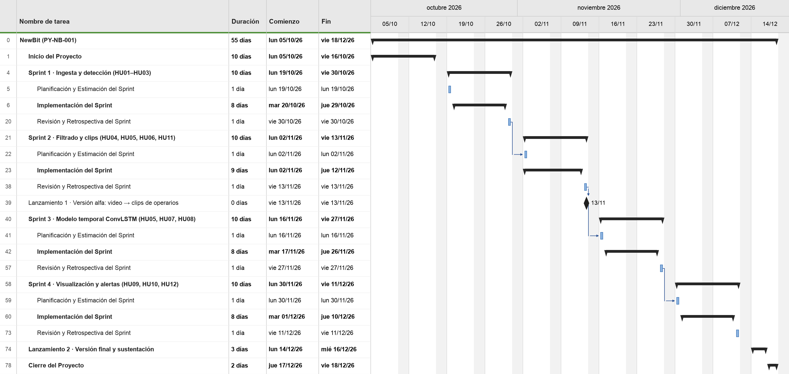
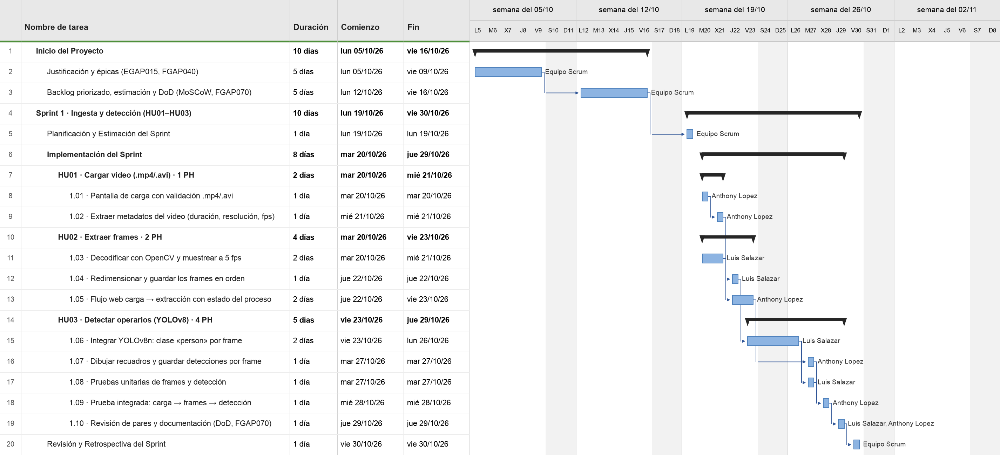
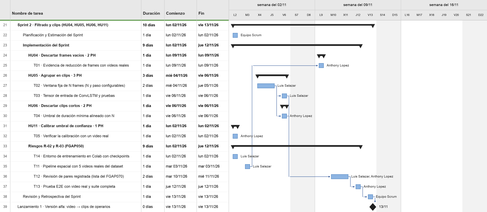
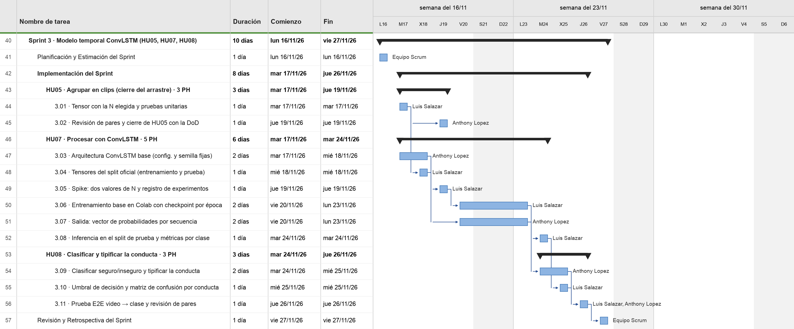
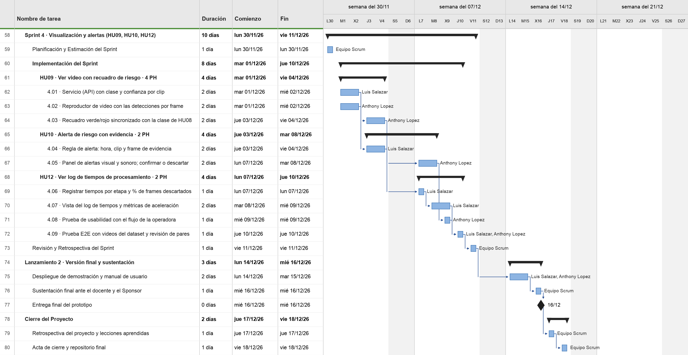

# FGAP080 – Cronograma de Planificación de Lanzamiento: NewBit

- **Archivos para entregar** (esta carpeta): `FGAP080_Cronograma_Lanzamiento_NewBit.pdf` y `FGAP080_Cronograma_Lanzamiento_NewBit.docx` (editable), más `FGAP080_Cronograma_Lanzamiento_NewBit.xml`, el proyecto de **MS Project** con tareas, vínculos y recursos. Para el `.mpp`, abrir el XML en MS Project (Archivo › Abrir › tipo «XML») y guardarlo como `.mpp`.
- **Estructura:** la del [formato FGAP080 del docente](../../material-del-profe/lanzamiento-fgap080-formato/lanzamiento-fgap080-formato.md): control de versiones, código y nombre del proyecto y el cronograma de MS Project. Además trae las secciones del ejemplo desarrollado del docente. PDF de 8 páginas: (1–2) control de versiones, código, **parámetros de la liberación** y **cronograma detallado de actividades** con resultado verificable; (3) **vista tipo Gantt por semanas** (sprints, historias y hitos ★); (4) **condiciones de uso** y vista resumen de MS Project como el modelo; (5–8) **detalle de las tareas de cada sprint** en MS Project, con responsable y predecesoras.
- **Generador:** `generar_fgap080.py` lee `plan_lanzamiento.py` (fuente única; `verificar()` comprueba las fechas del Acta y del FGAP130, que cada predecesora termine antes, que nadie tenga dos tareas el mismo día y que todo quepa en su sprint) y produce el XML (MSPDI), los Gantt en PNG (matplotlib, al estilo de MS Project) y el Word con `docx_nb.py` del FGAP110. PDF exportado con Pages.
- **Fecha:** 09/11/2026 · **Versión:** 1.0 · **Actividad individual** de Anthony Gabriel Lopez Yrribarren (Grupo D3, proyecto NewBit).
- **Calendario:** el del [Acta FGAP010 v2.0](../../../semana-02-scrum-y-acta/nuestras-entregas/FGAP010_Acta_Constitucion_NewBit/FGAP010_Acta_Constitucion_NewBit.md). El Sprint 2 usa las tareas y fechas del [FGAP130](../../../semana-08-riesgo-y-planificacion-del-sprint/nuestras-entregas/FGAP130_Cronograma_Sprint_02_NewBit/FGAP130_Cronograma_Sprint_02_NewBit.md) (02–13/11) sin las de la SC-001; los puntos por historia son los del [backlog](../../../semana-05-rsu-y-backlog/nuestras-entregas/Priorizacion_MoSCoW_100_Puntos_NewBit/Priorizacion_MoSCoW_100_Puntos_NewBit.md).

**Vista resumen (como el modelo del docente): fases de cada sprint**

**Detalle de tareas: Inicio del Proyecto · Sprint 1**

**Detalle de tareas: Sprint 2 · Lanzamiento 1**

**Detalle de tareas: Sprint 3**

**Detalle de tareas: Sprint 4 · Lanzamiento 2 · Cierre del Proyecto**

## Control de versiones
| Versión | Hecho por | Revisado por | Aprobado por | Fecha | Motivo |
|---|---|---|---|---|---|
| 1.0 | Anthony Gabriel Lopez Yrribarren | Albert Chumacero – Product Owner | Ricardo Salcedo – Sponsor | 09/11/2026 | Cronograma de lanzamiento con las tareas de los 4 sprints |

## Cronograma de planificación de lanzamiento
**Código y nombre del proyecto:** PY-NB-001 – Sistema web con Visión Artificial para la detección de actos inseguros en áreas operativas de manufactura metalmecánica (NewBit)

### Parámetros acordados de la liberación
| Responsable de priorización | Duración de cada sprint | Ventana del proyecto | Alcance de las liberaciones |
|---|---|---|---|
| Product Owner: Albert Chumacero | 10 días hábiles (2 semanas) | 05/10/2026 – 18/12/2026 | Prototipo académico con videos del dataset público; sin instalación en planta |

### Cronograma detallado (todas las filas del XML de MS Project)
En el Word y el PDF, el «Cronograma detallado de actividades» muestra hasta el nivel de historia de usuario con su resultado verificable; la «Vista tipo Gantt» marca por semanas cada sprint, cada historia y los hitos (★); las tareas técnicas se ven en las páginas de MS Project.

| Id | Nombre de tarea | Duración | Comienzo | Fin | Predecesoras | Recursos | Resultado / hito verificable |
|---|---|---|---|---|---|---|---|
| 0 | **NewBit (PY-NB-001)** | **55 días** | **lun 05/10/26** | **vie 18/12/26** | | | |
| 1 | **Inicio del Proyecto** | **10 días** | lun 05/10/26 | vie 16/10/26 | — |  | Acta, roles, justificación, épicas y backlog aprobados. |
| 2 | &nbsp;&nbsp;&nbsp;Justificación y épicas (EGAP015, FGAP040) | 5 días | lun 05/10/26 | vie 09/10/26 | — | Equipo Scrum | EGAP015 y FGAP040 con 12 historias de usuario. |
| 3 | &nbsp;&nbsp;&nbsp;Backlog priorizado, estimación y DoD (MoSCoW, FGAP070) | 5 días | lun 12/10/26 | vie 16/10/26 | 2 | Equipo Scrum | Backlog MoSCoW (31 PH), estimación y DoD (FGAP070). |
| 4 | **Sprint 1 · Ingesta y detección (HU01–HU03)** | **10 días** | lun 19/10/26 | vie 30/10/26 | — |  | Carga de video, frames y detección de operarios. |
| 5 | &nbsp;&nbsp;&nbsp;Planificación y Estimación del Sprint | 1 día | lun 19/10/26 | lun 19/10/26 | 3 | Equipo Scrum | Meta del sprint y tareas estimadas. |
| 6 | &nbsp;&nbsp;&nbsp;**Implementación del Sprint** | **8 días** | mar 20/10/26 | jue 29/10/26 | — |  | Historias implementadas con pruebas y revisión de pares. |
| 7 | &nbsp;&nbsp;&nbsp;&nbsp;&nbsp;&nbsp;**HU01 · Cargar video (.mp4/.avi) · 1 PH** | **2 días** | mar 20/10/26 | mié 21/10/26 | — |  | Sube .mp4/.avi y muestra duración, resolución y fps. |
| 8 | &nbsp;&nbsp;&nbsp;&nbsp;&nbsp;&nbsp;&nbsp;&nbsp;&nbsp;1.01 · Pantalla de carga con validación .mp4/.avi | 1 día | mar 20/10/26 | mar 20/10/26 | — | Anthony Lopez |  |
| 9 | &nbsp;&nbsp;&nbsp;&nbsp;&nbsp;&nbsp;&nbsp;&nbsp;&nbsp;1.02 · Extraer metadatos del video (duración, resolución, fps) | 1 día | mié 21/10/26 | mié 21/10/26 | 8 | Anthony Lopez |  |
| 10 | &nbsp;&nbsp;&nbsp;&nbsp;&nbsp;&nbsp;**HU02 · Extraer frames · 2 PH** | **4 días** | mar 20/10/26 | vie 23/10/26 | — |  | Frames a 5 fps guardados en orden. |
| 11 | &nbsp;&nbsp;&nbsp;&nbsp;&nbsp;&nbsp;&nbsp;&nbsp;&nbsp;1.03 · Decodificar con OpenCV y muestrear a 5 fps | 2 días | mar 20/10/26 | mié 21/10/26 | — | Luis Salazar |  |
| 12 | &nbsp;&nbsp;&nbsp;&nbsp;&nbsp;&nbsp;&nbsp;&nbsp;&nbsp;1.04 · Redimensionar y guardar los frames en orden | 1 día | jue 22/10/26 | jue 22/10/26 | 11 | Luis Salazar |  |
| 13 | &nbsp;&nbsp;&nbsp;&nbsp;&nbsp;&nbsp;&nbsp;&nbsp;&nbsp;1.05 · Flujo web carga → extracción con estado del proceso | 2 días | jue 22/10/26 | vie 23/10/26 | 9 | Anthony Lopez |  |
| 14 | &nbsp;&nbsp;&nbsp;&nbsp;&nbsp;&nbsp;**HU03 · Detectar operarios (YOLOv8) · 4 PH** | **5 días** | vie 23/10/26 | jue 29/10/26 | — |  | Recuadros de operarios (YOLOv8n) en cada frame. |
| 15 | &nbsp;&nbsp;&nbsp;&nbsp;&nbsp;&nbsp;&nbsp;&nbsp;&nbsp;1.06 · Integrar YOLOv8n: clase «person» por frame | 2 días | vie 23/10/26 | lun 26/10/26 | 12 | Luis Salazar |  |
| 16 | &nbsp;&nbsp;&nbsp;&nbsp;&nbsp;&nbsp;&nbsp;&nbsp;&nbsp;1.07 · Dibujar recuadros y guardar detecciones por frame | 1 día | mar 27/10/26 | mar 27/10/26 | 15, 13 | Anthony Lopez |  |
| 17 | &nbsp;&nbsp;&nbsp;&nbsp;&nbsp;&nbsp;&nbsp;&nbsp;&nbsp;1.08 · Pruebas unitarias de frames y detección | 1 día | mar 27/10/26 | mar 27/10/26 | 15 | Luis Salazar |  |
| 18 | &nbsp;&nbsp;&nbsp;&nbsp;&nbsp;&nbsp;&nbsp;&nbsp;&nbsp;1.09 · Prueba integrada: carga → frames → detección | 1 día | mié 28/10/26 | mié 28/10/26 | 16, 17 | Anthony Lopez |  |
| 19 | &nbsp;&nbsp;&nbsp;&nbsp;&nbsp;&nbsp;&nbsp;&nbsp;&nbsp;1.10 · Revisión de pares y documentación (DoD, FGAP070) | 1 día | jue 29/10/26 | jue 29/10/26 | 18 | Luis Salazar y Anthony Lopez |  |
| 20 | &nbsp;&nbsp;&nbsp;Revisión y Retrospectiva del Sprint | 1 día | vie 30/10/26 | vie 30/10/26 | 19 | Equipo Scrum | Demo al PO, historias aceptadas y acuerdos de mejora. |
| 21 | **Sprint 2 · Filtrado y clips (HU04, HU05, HU06, HU11)** | **10 días** | lun 02/11/26 | vie 13/11/26 | — |  | Pipeline espacial con filtrado, clips y calibración. |
| 22 | &nbsp;&nbsp;&nbsp;Planificación y Estimación del Sprint | 1 día | lun 02/11/26 | lun 02/11/26 | 20 | Equipo Scrum | Meta del sprint y tareas estimadas. |
| 23 | &nbsp;&nbsp;&nbsp;**Implementación del Sprint** | **9 días** | lun 02/11/26 | jue 12/11/26 | — |  | Historias implementadas con pruebas y revisión de pares. |
| 24 | &nbsp;&nbsp;&nbsp;&nbsp;&nbsp;&nbsp;**HU04 · Descartar frames vacíos · 2 PH** | **1 día** | lun 09/11/26 | lun 09/11/26 | — |  | % de frames vacíos descartados, medido con videos reales. |
| 25 | &nbsp;&nbsp;&nbsp;&nbsp;&nbsp;&nbsp;&nbsp;&nbsp;&nbsp;T01 · Evidencia de reducción de frames con videos reales | 1 día | lun 09/11/26 | lun 09/11/26 | 35 | Anthony Lopez |  |
| 26 | &nbsp;&nbsp;&nbsp;&nbsp;&nbsp;&nbsp;**HU05 · Agrupar en clips · 3 PH** | **3 días** | mié 04/11/26 | vie 06/11/26 | — |  | Clips de N frames y tensor de entrada de ConvLSTM. |
| 27 | &nbsp;&nbsp;&nbsp;&nbsp;&nbsp;&nbsp;&nbsp;&nbsp;&nbsp;T02 · Ventana fija de N frames (N y paso configurables) | 2 días | mié 04/11/26 | jue 05/11/26 | — | Luis Salazar |  |
| 28 | &nbsp;&nbsp;&nbsp;&nbsp;&nbsp;&nbsp;&nbsp;&nbsp;&nbsp;T03 · Tensor de entrada de ConvLSTM y pruebas | 1 día | vie 06/11/26 | vie 06/11/26 | 27 | Luis Salazar |  |
| 29 | &nbsp;&nbsp;&nbsp;&nbsp;&nbsp;&nbsp;**HU06 · Descartar clips cortos · 2 PH** | **1 día** | vie 06/11/26 | vie 06/11/26 | — |  | Clips cortos descartados con el umbral alineado a N. |
| 30 | &nbsp;&nbsp;&nbsp;&nbsp;&nbsp;&nbsp;&nbsp;&nbsp;&nbsp;T04 · Umbral de duración mínima alineado con N | 1 día | vie 06/11/26 | vie 06/11/26 | 27 | Anthony Lopez |  |
| 31 | &nbsp;&nbsp;&nbsp;&nbsp;&nbsp;&nbsp;**HU11 · Calibrar umbral de confianza · 1 PH** | **1 día** | lun 02/11/26 | lun 02/11/26 | — |  | Umbral de confianza ajustable y registrado. |
| 32 | &nbsp;&nbsp;&nbsp;&nbsp;&nbsp;&nbsp;&nbsp;&nbsp;&nbsp;T05 · Verificar la calibración con un video real | 1 día | lun 02/11/26 | lun 02/11/26 | — | Anthony Lopez |  |
| 33 | &nbsp;&nbsp;&nbsp;&nbsp;&nbsp;&nbsp;**Riesgos R-02 y R-03 (FGAP050)** | **9 días** | lun 02/11/26 | jue 12/11/26 | — |  | Pipeline con videos reales, revisión de pares y E2E. |
| 34 | &nbsp;&nbsp;&nbsp;&nbsp;&nbsp;&nbsp;&nbsp;&nbsp;&nbsp;T14 · Entorno de entrenamiento en Colab con checkpoints | 1 día | lun 02/11/26 | lun 02/11/26 | — | Luis Salazar |  |
| 35 | &nbsp;&nbsp;&nbsp;&nbsp;&nbsp;&nbsp;&nbsp;&nbsp;&nbsp;T11 · Pipeline espacial con 5 videos reales del dataset | 1 día | mar 03/11/26 | mar 03/11/26 | — | Luis Salazar |  |
| 36 | &nbsp;&nbsp;&nbsp;&nbsp;&nbsp;&nbsp;&nbsp;&nbsp;&nbsp;T12 · Revisión de pares registrada (lista del FGAP070) | 2 días | mar 10/11/26 | mié 11/11/26 | 28, 30 | Luis Salazar y Anthony Lopez |  |
| 37 | &nbsp;&nbsp;&nbsp;&nbsp;&nbsp;&nbsp;&nbsp;&nbsp;&nbsp;T13 · Prueba E2E con video real y suite completa | 1 día | jue 12/11/26 | jue 12/11/26 | 36 | Anthony Lopez |  |
| 38 | &nbsp;&nbsp;&nbsp;Revisión y Retrospectiva del Sprint | 1 día | vie 13/11/26 | vie 13/11/26 | 37 | Equipo Scrum | Demo al PO, historias aceptadas y acuerdos de mejora. |
| 39 | ◆ Lanzamiento 1 · Versión alfa: video → clips de operarios | 0 días | vie 13/11/26 | vie 13/11/26 | 38 |  | Demo alfa: video → clips de operarios. |
| 40 | **Sprint 3 · Modelo temporal ConvLSTM (HU05, HU07, HU08)** | **10 días** | lun 16/11/26 | vie 27/11/26 | — |  | ConvLSTM entrenado: clase segura/insegura con métricas. |
| 41 | &nbsp;&nbsp;&nbsp;Planificación y Estimación del Sprint | 1 día | lun 16/11/26 | lun 16/11/26 | 39 | Equipo Scrum | Meta del sprint y tareas estimadas. |
| 42 | &nbsp;&nbsp;&nbsp;**Implementación del Sprint** | **8 días** | mar 17/11/26 | jue 26/11/26 | — |  | Historias implementadas con pruebas y revisión de pares. |
| 43 | &nbsp;&nbsp;&nbsp;&nbsp;&nbsp;&nbsp;**HU05 · Agrupar en clips (cierre del arrastre) · 3 PH** | **3 días** | mar 17/11/26 | jue 19/11/26 | — |  | HU05 aceptada con la DoD (tensor con la N elegida). |
| 44 | &nbsp;&nbsp;&nbsp;&nbsp;&nbsp;&nbsp;&nbsp;&nbsp;&nbsp;3.01 · Tensor con la N elegida y pruebas unitarias | 1 día | mar 17/11/26 | mar 17/11/26 | — | Luis Salazar |  |
| 45 | &nbsp;&nbsp;&nbsp;&nbsp;&nbsp;&nbsp;&nbsp;&nbsp;&nbsp;3.02 · Revisión de pares y cierre de HU05 con la DoD | 1 día | jue 19/11/26 | jue 19/11/26 | 44 | Anthony Lopez |  |
| 46 | &nbsp;&nbsp;&nbsp;&nbsp;&nbsp;&nbsp;**HU07 · Procesar con ConvLSTM · 5 PH** | **6 días** | mar 17/11/26 | mar 24/11/26 | — |  | Vector de probabilidades por secuencia en el split de prueba. |
| 47 | &nbsp;&nbsp;&nbsp;&nbsp;&nbsp;&nbsp;&nbsp;&nbsp;&nbsp;3.03 · Arquitectura ConvLSTM base (config. y semilla fijas) | 2 días | mar 17/11/26 | mié 18/11/26 | — | Anthony Lopez |  |
| 48 | &nbsp;&nbsp;&nbsp;&nbsp;&nbsp;&nbsp;&nbsp;&nbsp;&nbsp;3.04 · Tensores del split oficial (entrenamiento y prueba) | 1 día | mié 18/11/26 | mié 18/11/26 | 44 | Luis Salazar |  |
| 49 | &nbsp;&nbsp;&nbsp;&nbsp;&nbsp;&nbsp;&nbsp;&nbsp;&nbsp;3.05 · Spike: dos valores de N y registro de experimentos | 1 día | jue 19/11/26 | jue 19/11/26 | 47, 48 | Luis Salazar |  |
| 50 | &nbsp;&nbsp;&nbsp;&nbsp;&nbsp;&nbsp;&nbsp;&nbsp;&nbsp;3.06 · Entrenamiento base en Colab con checkpoint por época | 2 días | vie 20/11/26 | lun 23/11/26 | 49 | Luis Salazar |  |
| 51 | &nbsp;&nbsp;&nbsp;&nbsp;&nbsp;&nbsp;&nbsp;&nbsp;&nbsp;3.07 · Salida: vector de probabilidades por secuencia | 2 días | vie 20/11/26 | lun 23/11/26 | 47 | Anthony Lopez |  |
| 52 | &nbsp;&nbsp;&nbsp;&nbsp;&nbsp;&nbsp;&nbsp;&nbsp;&nbsp;3.08 · Inferencia en el split de prueba y métricas por clase | 1 día | mar 24/11/26 | mar 24/11/26 | 50, 51 | Luis Salazar |  |
| 53 | &nbsp;&nbsp;&nbsp;&nbsp;&nbsp;&nbsp;**HU08 · Clasificar y tipificar la conducta · 3 PH** | **3 días** | mar 24/11/26 | jue 26/11/26 | — |  | Clase segura/insegura y tipo de conducta; matriz de confusión. |
| 54 | &nbsp;&nbsp;&nbsp;&nbsp;&nbsp;&nbsp;&nbsp;&nbsp;&nbsp;3.09 · Clasificar seguro/inseguro y tipificar la conducta | 2 días | mar 24/11/26 | mié 25/11/26 | 51 | Anthony Lopez |  |
| 55 | &nbsp;&nbsp;&nbsp;&nbsp;&nbsp;&nbsp;&nbsp;&nbsp;&nbsp;3.10 · Umbral de decisión y matriz de confusión por conducta | 1 día | mié 25/11/26 | mié 25/11/26 | 52 | Luis Salazar |  |
| 56 | &nbsp;&nbsp;&nbsp;&nbsp;&nbsp;&nbsp;&nbsp;&nbsp;&nbsp;3.11 · Prueba E2E video → clase y revisión de pares | 1 día | jue 26/11/26 | jue 26/11/26 | 54, 55 | Luis Salazar y Anthony Lopez |  |
| 57 | &nbsp;&nbsp;&nbsp;Revisión y Retrospectiva del Sprint | 1 día | vie 27/11/26 | vie 27/11/26 | 56 | Equipo Scrum | Demo al PO, historias aceptadas y acuerdos de mejora. |
| 58 | **Sprint 4 · Visualización y alertas (HU09, HU10, HU12)** | **10 días** | lun 30/11/26 | vie 11/12/26 | — |  | Video con recuadro de riesgo, alertas y log de tiempos. |
| 59 | &nbsp;&nbsp;&nbsp;Planificación y Estimación del Sprint | 1 día | lun 30/11/26 | lun 30/11/26 | 57 | Equipo Scrum | Meta del sprint y tareas estimadas. |
| 60 | &nbsp;&nbsp;&nbsp;**Implementación del Sprint** | **8 días** | mar 01/12/26 | jue 10/12/26 | — |  | Historias implementadas con pruebas y revisión de pares. |
| 61 | &nbsp;&nbsp;&nbsp;&nbsp;&nbsp;&nbsp;**HU09 · Ver video con recuadro de riesgo · 4 PH** | **4 días** | mar 01/12/26 | vie 04/12/26 | — |  | Video con recuadro verde/rojo según la clase. |
| 62 | &nbsp;&nbsp;&nbsp;&nbsp;&nbsp;&nbsp;&nbsp;&nbsp;&nbsp;4.01 · Servicio (API) con clase y confianza por clip | 2 días | mar 01/12/26 | mié 02/12/26 | — | Luis Salazar |  |
| 63 | &nbsp;&nbsp;&nbsp;&nbsp;&nbsp;&nbsp;&nbsp;&nbsp;&nbsp;4.02 · Reproductor de video con las detecciones por frame | 2 días | mar 01/12/26 | mié 02/12/26 | — | Anthony Lopez |  |
| 64 | &nbsp;&nbsp;&nbsp;&nbsp;&nbsp;&nbsp;&nbsp;&nbsp;&nbsp;4.03 · Recuadro verde/rojo sincronizado con la clase de HU08 | 2 días | jue 03/12/26 | vie 04/12/26 | 62, 63 | Anthony Lopez |  |
| 65 | &nbsp;&nbsp;&nbsp;&nbsp;&nbsp;&nbsp;**HU10 · Alerta de riesgo con evidencia · 2 PH** | **4 días** | jue 03/12/26 | mar 08/12/26 | — |  | Alerta con hora y evidencia; confirmar o descartar. |
| 66 | &nbsp;&nbsp;&nbsp;&nbsp;&nbsp;&nbsp;&nbsp;&nbsp;&nbsp;4.04 · Regla de alerta: hora, clip y frame de evidencia | 2 días | jue 03/12/26 | vie 04/12/26 | 62 | Luis Salazar |  |
| 67 | &nbsp;&nbsp;&nbsp;&nbsp;&nbsp;&nbsp;&nbsp;&nbsp;&nbsp;4.05 · Panel de alertas visual y sonoro; confirmar o descartar | 2 días | lun 07/12/26 | mar 08/12/26 | 64, 66 | Anthony Lopez |  |
| 68 | &nbsp;&nbsp;&nbsp;&nbsp;&nbsp;&nbsp;**HU12 · Ver log de tiempos de procesamiento · 2 PH** | **4 días** | lun 07/12/26 | jue 10/12/26 | — |  | Log de tiempos por etapa y ahorro de cómputo. |
| 69 | &nbsp;&nbsp;&nbsp;&nbsp;&nbsp;&nbsp;&nbsp;&nbsp;&nbsp;4.06 · Registrar tiempos por etapa y % de frames descartados | 1 día | lun 07/12/26 | lun 07/12/26 | 66 | Luis Salazar |  |
| 70 | &nbsp;&nbsp;&nbsp;&nbsp;&nbsp;&nbsp;&nbsp;&nbsp;&nbsp;4.07 · Vista del log de tiempos y métricas de aceleración | 2 días | mar 08/12/26 | mié 09/12/26 | 69 | Luis Salazar |  |
| 71 | &nbsp;&nbsp;&nbsp;&nbsp;&nbsp;&nbsp;&nbsp;&nbsp;&nbsp;4.08 · Prueba de usabilidad con el flujo de la operadora | 1 día | mié 09/12/26 | mié 09/12/26 | 67 | Anthony Lopez |  |
| 72 | &nbsp;&nbsp;&nbsp;&nbsp;&nbsp;&nbsp;&nbsp;&nbsp;&nbsp;4.09 · Prueba E2E con videos del dataset y revisión de pares | 1 día | jue 10/12/26 | jue 10/12/26 | 70, 71 | Luis Salazar y Anthony Lopez |  |
| 73 | &nbsp;&nbsp;&nbsp;Revisión y Retrospectiva del Sprint | 1 día | vie 11/12/26 | vie 11/12/26 | 72 | Equipo Scrum | Demo al PO, historias aceptadas y acuerdos de mejora. |
| 74 | **Lanzamiento 2 · Versión final y sustentación** | **3 días** | lun 14/12/26 | mié 16/12/26 | — |  | Prototipo final, manual y sustentación. |
| 75 | &nbsp;&nbsp;&nbsp;Despliegue de demostración y manual de usuario | 2 días | lun 14/12/26 | mar 15/12/26 | 73 | Luis Salazar y Anthony Lopez | Demo desplegada y manual de usuario. |
| 76 | &nbsp;&nbsp;&nbsp;Sustentación final ante el docente y el Sponsor | 1 día | mié 16/12/26 | mié 16/12/26 | 75 | Equipo Scrum | Presentación final ante el docente y el Sponsor. |
| 77 | &nbsp;&nbsp;&nbsp;◆ Entrega final del prototipo | 0 días | mié 16/12/26 | mié 16/12/26 | 76 |  | Incremento final aceptado. |
| 78 | **Cierre del Proyecto** | **2 días** | jue 17/12/26 | vie 18/12/26 | — |  | Lecciones aprendidas, acta de cierre y repositorio. |
| 79 | &nbsp;&nbsp;&nbsp;Retrospectiva del proyecto y lecciones aprendidas | 1 día | jue 17/12/26 | jue 17/12/26 | 77 | Equipo Scrum | Lecciones aprendidas registradas. |
| 80 | &nbsp;&nbsp;&nbsp;Acta de cierre y repositorio final | 1 día | vie 18/12/26 | vie 18/12/26 | 79 | Equipo Scrum | Acta de cierre y repositorio final publicados. |

Predecesoras fin → comienzo. Duración en días hábiles (lunes a viernes). PH = puntos de historia (5 h por PH, como en el burndown).

## Decisiones tomadas (propuesta del equipo)
- **Sprints de 10 días hábiles** (2 semanas, como fija el Acta): día 1 Planificación y Estimación, días 2–9 Implementación y día 10 Revisión y Retrospectiva (el modelo del docente usa 3 + 20 + 2 días porque su ejemplo es de sprints de 25 días).
- **Tareas por historia de usuario:** cada sprint baja a tareas técnicas de 1 o 2 días con responsable, como en la EDT del Sprint 2 (FGAP110). Luis lleva datos y modelos (OpenCV, YOLOv8, tensores, ConvLSTM, métricas, API) y Anthony la web, la integración y las pruebas, según los roles del FGAP030. Cada historia cierra con pruebas y revisión de pares (DoD, FGAP070).
- **Sprint 1:** las tareas del Scrumboard del Sprint 1 (tablero Kanban, semana 5). **Sprint 2:** T01–T05 y T11–T14 del FGAP110/FGAP130 con sus fechas (T05 y T14 empiezan el día de la planificación, como en el FGAP130); las tareas T06–T10 dependen de la SC-001 (adelantar HU07), que el backlog deja en el Sprint 3, así que no entran. **Sprint 3:** cierre del arrastre de HU05 (como en el burndown), HU07 y HU08. **Sprint 4:** HU09, HU10 y HU12.
- **Lanzamiento 1 como hito (0 días) el 13/11**, en la revisión del Sprint 2: versión alfa del pipeline espacial (carga, frames, YOLO, filtrado y clips). El Acta pone los sprints seguidos, así que no hay hueco para un lanzamiento de 10 días como en el modelo.
- **Lanzamiento 2 (14–16/12) y Cierre (17–18/12)** reparten la semana de «Cierre y sustentación» del Acta, con sus tareas y el hito de entrega final.
- **Feriados no descontados:** 08/10, Combate de Angamos (Fase de Inicio); 08/12, Inmaculada Concepción (Sprint 4). Mismo criterio que el Acta y el burndown. Si el equipo no trabaja esos días, se marcan como feriados (en MS Project o en Mini Project) y las fechas se recalculan solas.

## Condiciones de uso del cronograma
- Días hábiles de lunes a viernes. El Acta fija sprints de 2 semanas sin descontar los feriados del 08/10 (Fase de Inicio) y del 08/12 (Sprint 4); si el equipo no trabaja esos días, se marcan como no laborables y las fechas se recalculan.
- Lanzamiento 1: demostración alfa interna del pipeline espacial con videos del dataset público (Önal y Dandıl, 2024; CC BY 4.0). Lanzamiento 2: entrega académica final del prototipo. Ninguno autoriza su uso en una planta real sin validación ni permisos.
- Las tareas de los Sprints 3 y 4 son planificación: se revisan en la Planificación de cada sprint y en cada revisión, como pide Scrum.
- Si el Product Owner aprueba una solicitud de cambio (FGAP090), por ejemplo la SC-001 que adelanta HU07, se actualiza este cronograma con una nueva versión.

## Cómo pasarlo a MS Project
1. Con **MS Project (Windows)**: Archivo › Abrir › tipo «Formato XML» › `FGAP080_Cronograma_Lanzamiento_NewBit.xml` › «Como nuevo proyecto». Luego Guardar como `.mpp`.
2. En **Mac**: abrir el mismo XML con ProjectLibre (gratuito) o con Mini Project.
3. **Para editarlo sin MS Project:** `python3 herramientas/mini-project/servidor.py` abre [Mini Project](../../../../herramientas/mini-project/README.md); se abre este XML, se edita como en Project y el botón «Word/PDF» corre `generar_fgap080.py --xml … --pdf`, que rehace el Word, los PNG, el `.md` y el PDF.

## Estado
Completo en Word y PDF, sin campos «POR CONFIRMAR». Lo único que no se puede hacer en Mac es el archivo `.mpp`: si el docente lo pide, se abre el XML en una PC con MS Project y se guarda como `.mpp` (el contenido ya está listo). Las tareas y fechas de los Sprints 3 y 4 son la planificación propuesta, no avance real.
