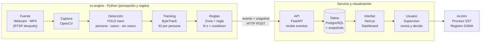
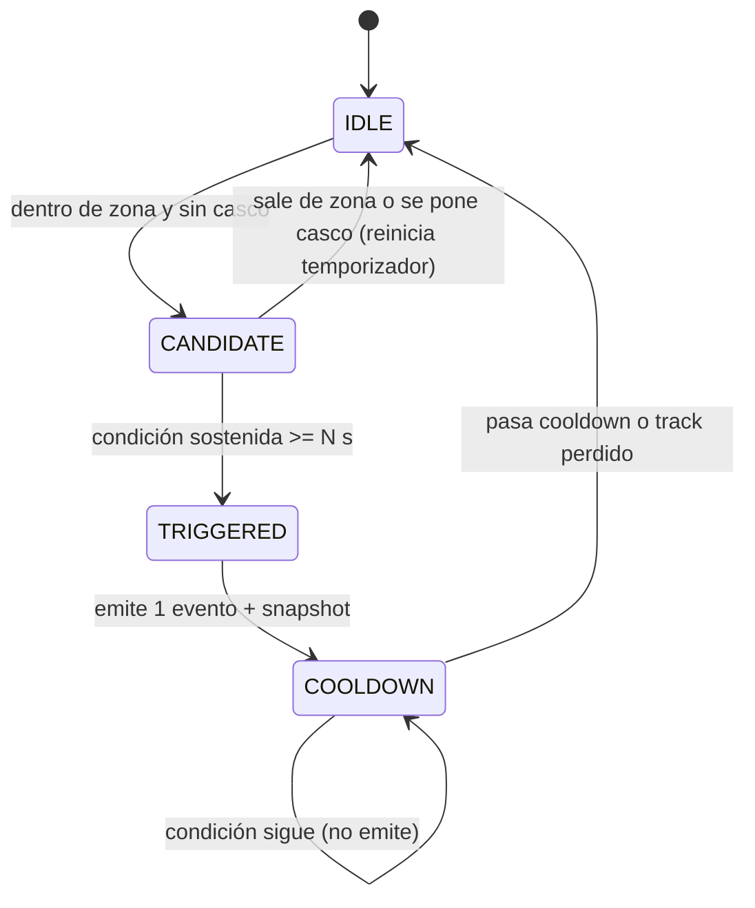
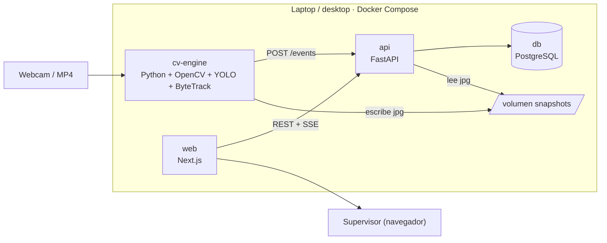

# NewBit – Arquitectura técnica completa del MVP

- **Basada en:** diapositiva 6 de `VisionOps Industrial.pptx` ("Una cadena simple, de extremo a extremo"), más las diapositivas 4, 7–9, 13–14 y los documentos `01` y `02` de esta carpeta.
- **Semana:** 3 (previa al Sprint 1 del Acta VIGIA, que empieza el 05/10/2026)
- **Alcance de este documento:** primer experimento **1 cámara · 1 zona · 1 regla** ("persona entra en zona operacional sin casco requerido durante N segundos").
- **Ojo con el alcance formal:** el Acta VIGIA (`descartado/vigia-industrial/semana-02/Acta_Constitucion_VIGIA_Industrial_SIDERPERU/Acta_Constitucion_VIGIA_Industrial_SIDERPERU.md`) pide **4 cámaras RTSP, 8 zonas, 3 reglas (casco, chaleco, zona restringida), alertas por correo, CSV y roles**. Esta arquitectura ya permite escalar a eso sin rehacerla (cada cámara = una fuente; cada zona/regla = configuración), pero hay que añadir: clase `chaleco`, regla de zona restringida, varias fuentes en paralelo con ≥ 5 fps cada una, envío de correo y exportación CSV.
- **Convención de origen:**
  - 📄 **[Doc]** = viene de los documentos del proyecto.
  - 🧩 **[Propuesta]** = diseño técnico que añado para completar la arquitectura; es decisión del equipo aceptarlo o cambiarlo.

## 1. Visión de la cadena

Es la cadena de la diapositiva 6: percepción y reglas en Python (fila 1) → servicio y visualización (fila 2). Mismo patrón que NVIDIA DeepStream: fuente → inferencia → tracking → analytics → evento. 📄



**Principios de diseño** 📄
1. Una sola cadena funcional de extremo a extremo antes de añadir infraestructura distribuida (sin Kafka, sin Kubernetes).
2. El núcleo no sabe qué es un casco: evalúa objetos, zonas, atributos y reglas → para otro caso se cambia regla/zona/clases, no backend, BD ni dashboard.
3. Se evalúan **eventos**, no frames aislados.
4. La decisión sigue siendo humana; el sistema entrega evidencia y alerta. No se integra con SSMA en el MVP: la acción posterior es un proceso humano.

## 2. Las 10 etapas de un vistazo

| # | Etapa | Tecnología | Responsabilidad | Entrada → Salida | Proceso |
|---|---|---|---|---|---|
| 1 | Fuente | Webcam · MP4 (RTSP después) 📄 | Origen del video | — → stream/archivo | externo |
| 2 | Captura | OpenCV (FFmpeg) 📄 | Lee frames, normaliza, expone estado de la fuente | fuente → `FramePacket` | cv-engine |
| 3 | Detección | Ultralytics YOLO nano 📄 | Qué hay en el frame (clase + bbox + confianza); **no decide incumplimiento** | `FramePacket` → `Detection[]` | cv-engine |
| 4 | Tracking | ByteTrack 📄 | ID temporal por persona entre frames | `Detection[]` → `Track[]` | cv-engine |
| 5 | Reglas | Python: zonas + condiciones + cooldown 📄 | Zona, ventana de N s, cooldown, deduplicación; genera el evento | `Track[]` → `Event` + snapshot | cv-engine |
| 6 | API | FastAPI 📄 | Recibe eventos, expone configuración y consulta | `Event` → registro | api |
| 7 | Datos | PostgreSQL + snapshots 📄 | Metadata de eventos, configuración, evidencia | registro → persistido | db + volumen |
| 8 | Interfaz | Next.js 📄 | Dashboard: eventos, configuración, historial | API → pantalla | web |
| 9 | Usuario | Supervisor 📄 | Revisa evidencia y decide | pantalla → decisión | humano |
| 10 | Acción | Proceso SST · registro SSMA 📄 | Consecuencia real fuera del sistema | decisión → hallazgo registrado | humano/externo |

## 3. Contratos de datos entre etapas

### 3.1 `FramePacket` (captura → detección) 🧩
Propuesta del propio deck de arquitectura, no está fijada en el discovery.
```python
@dataclass
class FramePacket:
    camera_id: str
    timestamp: datetime        # momento de captura
    frame: np.ndarray          # BGR, HxWx3
    width: int
    height: int
    fps: float
    source_status: str         # connected | reconnecting | ended | error
```

### 3.2 `Detection` y `Track` 🧩
```python
@dataclass
class Detection:
    cls: str                   # person | helmet | no_helmet
    bbox: tuple[float,float,float,float]   # x1,y1,x2,y2 en píxeles
    conf: float                # 0..1

@dataclass
class Track:
    track_id: int              # ID temporal de ByteTrack
    bbox: tuple[float,float,float,float]
    has_helmet: bool | None    # None si no se pudo determinar en este frame
    helmet_conf: float | None
    timestamp: datetime
```

### 3.3 `Event` (reglas → API) 📄 + 🧩
Ejemplo del PPT (diapositiva 4):
```json
{
  "camera": "cam-01",
  "zone": "zona-operacional-A",
  "rule": "casco_requerido",
  "track_id": 17,
  "timestamp": "2026-10-12T09:41:07",
  "confidence": 0.87,
  "snapshot": "evt_0192.jpg"
}
```
Contrato mínimo del deck de arquitectura: `timestamp, camera_id, zone_id, rule_id, track_id, confidence, snapshot_uri, status`.

> ⚠️ **Inconsistencia a decidir:** el PPT usa `camera/zone/rule/snapshot` (nombres) y el deck de arquitectura usa `camera_id/zone_id/rule_id/snapshot_uri` (ids). 🧩 Recomiendo el segundo para la API y la BD (ids estables), y mostrar los nombres en la UI.

Contrato propuesto para `POST /events`:
```json
{
  "camera_id": "cam-01",
  "zone_id": "zona-operacional-A",
  "rule_id": "casco_requerido",
  "track_id": 17,
  "timestamp": "2026-10-12T09:41:07Z",
  "confidence": 0.87,
  "snapshot_uri": "evt_0192.jpg",
  "status": "new"
}
```
`status`: `new → reviewed → actioned | dismissed` (permite medir "accionable" y T_action). El snapshot se sube como `multipart` en la misma llamada o por referencia a un volumen compartido (ver §8).

## 4. Detalle por etapa

### 4.1 Fuente y captura (OpenCV)
- 📄 MVP: webcam 720p o archivo MP4, procesamiento local, estado de la fuente (`US-01`). RTSP, GStreamer y DeepStream son escalado posterior.
- 🧩 Un hilo lector con cola acotada (tamaño 1–2) que **descarta frames viejos** si la inferencia va más lenta que la fuente; así la latencia no crece sin límite.
- 🧩 Estados de fuente: `connected`, `reconnecting` (reintento con espera creciente), `ended` (MP4 terminado), `error`. Se reportan a la API (`GET /sources/{id}`).
- 🧩 Para MP4 se puede procesar en tiempo real (respetando FPS) o a máxima velocidad; para medir latencia usar tiempo real.

### 4.2 Detección (YOLO nano)
- 📄 Modelo: Ultralytics YOLO nano con pesos preentrenados en COCO. Para el MVP **3 clases: persona, casco, sin casco**.
- 📄 Entrenamiento (diapositivas 8–9): ver §9.
- 🧩 Salida: `Detection[]` por frame; umbral de confianza **por clase** (calibración paso 4 del PPT).
- 📄 Inferencia en CPU o Apple Silicon en la demo; exportación a ONNX/TensorRT para edge después.

### 4.3 Asociar casco ↔ persona 🧩
YOLO devuelve cajas sueltas; hay que decidir cuál `casco`/`sin_casco` pertenece a cada persona:
1. Para cada `person` (ya con track), definir la **región de cabeza** = tercio superior de su bbox.
2. Buscar `helmet`/`no_helmet` cuyo centro caiga dentro de esa región (o IoU > umbral con ella).
3. Si hay varias, elegir la de mayor confianza; si no hay ninguna → `has_helmet = None` (desconocido).
4. **`None` no cuenta como "sin casco"**: una oclusión no debe generar alarma (control de falsos positivos).

### 4.4 Tracking (ByteTrack)
- 📄 ID temporal por persona; habilita persistencia, cooldown por track/regla y deduplicación.
- 🧩 Estado de casco por track = **voto/suavizado sobre los últimos N frames** (p. ej. mayoría o media móvil de la confianza), no el valor de un frame.
- 🧩 Un track se considera perdido tras M frames sin detección; su estado de regla se cierra.

### 4.5 Zonas
- 📄 Zona = polígono virtual asociado a una cámara (`US-02`); define el contexto espacial.
- 🧩 Punto de prueba = **centro inferior de la bbox** (los pies), no el centro, para ubicar bien a la persona en el plano del suelo.
- 🧩 Prueba punto-en-polígono (ray casting / `cv2.pointPolygonTest`). Los polígonos se guardan **normalizados (0–1)** para ser independientes de la resolución.
- 🧩 Eventos de zona por track: `enter`, `inside`, `exit`.

### 4.6 Motor de reglas (Rule Engine)
📄 Regla = objeto/atributo + zona + ventana temporal + condición + cooldown; resultado true/false por track. Primer experimento:

```
track.class = person ∧ inside(zona_A) ∧ helmet = false ∧ duration ≥ N s  →  EVENT
```

🧩 Configuración de la regla (JSON en BD):
```json
{
  "rule_id": "casco_requerido",
  "zone_id": "zona-operacional-A",
  "target_class": "person",
  "required_attribute": "helmet",
  "window_seconds": 2.0,
  "cooldown_seconds": 30,
  "min_confidence": 0.5,
  "enabled": true
}
```

🧩 **Máquina de estados por (track_id, rule_id):**



- **Tolerancia a ruido:** el temporizador de `CANDIDATE` no se reinicia por huecos cortos (p. ej. ≤ 0.5 s sin detección); sí por casco visible o salida de zona.
- **Deduplicación:** clave `(track_id, rule_id)`; máximo 1 evento mientras dura el cooldown (criterio de éxito: ≤ 1 evento por persona/regla en cooldown).
- 🧩 Si ByteTrack reasigna ID a la misma persona, podría duplicarse un evento; mitigación: cooldown adicional por **zona + regla** (parámetro a calibrar con los 30 escenarios).

### 4.7 Event Engine (evidencia)
1. Al disparar, guarda **un snapshot** del frame actual con bbox y polígono dibujados (`evt_<id>.jpg`).
2. Construye el `Event` (§3.3) y lo envía a la API.
3. 🧩 Si la API no responde, **reintenta desde una cola local en disco** (no pierde el evento).
4. 📄 Privacidad: solo snapshots de eventos, **no video continuo**; sin reconocimiento facial.

### 4.8 API (FastAPI) 🧩
| Método | Ruta | Propósito | US |
|---|---|---|---|
| `POST` | `/sources` | Registrar fuente (MP4/webcam) | US-01 |
| `GET` | `/sources/{id}` | Estado de la fuente | US-01 |
| `PUT` | `/zones/{id}` | Guardar/editar zona (polígono) | US-02 |
| `PUT` | `/rules/{id}` | Crear/editar regla y asociar zona | US-02 |
| `POST` | `/events` | Recibir evento (desde cv-engine) | US-04 |
| `GET` | `/events` | Listar con filtros `from,to,camera_id,zone_id,rule_id,status` + paginación | US-05 |
| `GET` | `/events/{id}` | Detalle + evidencia | US-04 |
| `PATCH` | `/events/{id}` | Marcar `reviewed/actioned/dismissed` | US-06 |
| `GET` | `/metrics` | Precisión, recall, duplicados, latencia | US-06 |
| `GET` | `/events/stream` | SSE/WebSocket para push al dashboard (≤ 5 s) | US-04 |

- Validación con Pydantic; OpenAPI automático (`/docs`).
- Acceso por roles y log de accesos (requisito de privacidad 📄); autenticación mínima (token/JWT) 🧩.

### 4.9 Datos (PostgreSQL + snapshots) 🧩
Entidades 📄: Camera, Zone, Rule, Event, Evidence.

```sql
CREATE TABLE camera (
  id TEXT PRIMARY KEY, name TEXT, source_type TEXT,      -- mp4 | webcam | rtsp
  source_uri TEXT, status TEXT, created_at TIMESTAMPTZ DEFAULT now()
);
CREATE TABLE zone (
  id TEXT PRIMARY KEY, camera_id TEXT REFERENCES camera(id),
  name TEXT, polygon JSONB NOT NULL                       -- [[x,y],...] normalizado 0-1
);
CREATE TABLE rule (
  id TEXT PRIMARY KEY, zone_id TEXT REFERENCES zone(id),
  config JSONB NOT NULL, enabled BOOLEAN DEFAULT true
);
CREATE TABLE event (
  id BIGSERIAL PRIMARY KEY,
  camera_id TEXT REFERENCES camera(id), zone_id TEXT REFERENCES zone(id),
  rule_id TEXT REFERENCES rule(id), track_id INT,
  occurred_at TIMESTAMPTZ NOT NULL, received_at TIMESTAMPTZ DEFAULT now(),
  confidence REAL, status TEXT DEFAULT 'new'
);
CREATE TABLE evidence (
  id BIGSERIAL PRIMARY KEY, event_id BIGINT REFERENCES event(id),
  snapshot_uri TEXT NOT NULL, width INT, height INT
);
CREATE INDEX ON event (occurred_at DESC);
CREATE INDEX ON event (camera_id, zone_id, rule_id);
```
- `received_at − occurred_at` mide la latencia de entrega a la API (parte del criterio ≤ 5 s).
- 📄 Snapshots separados del registro: en el MVP, **volumen de disco** compartido; en el escalado, object storage.
- 🧩 Retención configurable (job que borra snapshots/eventos antiguos) → requisito de privacidad.

### 4.10 Interfaz (Next.js) 📄 + 🧩
Mockup conceptual del deck: Eventos · Cámaras · Zonas · Reglas · Historial.
- **Eventos:** lista reciente (zona, regla, hora, estado) con snapshot y acciones *revisado/accionado/descartado*.
- **Cámaras/Fuentes:** registrar fuente y ver estado (US-01).
- **Zonas y Reglas:** dibujar polígono sobre un frame de referencia y asociar la regla (US-02).
- **Historial:** filtros por fecha, cámara, zona y regla (US-05).
- **Métricas:** reporte de precisión/recall/latencia (US-06).
- Tiempo real por SSE/WebSocket o polling corto.

### 4.11 Usuario y acción
El supervisor revisa la evidencia y decide; la acción real (registro en SSMA, intervención) ocurre **fuera** del sistema en el MVP. 📄 Una detección **nunca** se convierte en sanción automática.

## 5. Despliegue (Docker Compose local) 📄 + 🧩



| Servicio | Imagen/base | Puerto | Notas |
|---|---|---|---|
| `cv-engine` | python + opencv + ultralytics | — | Acceso a webcam/MP4; en macOS la webcam no pasa bien por Docker → correr este servicio **en el host** y el resto en Compose 🧩 |
| `api` | python + fastapi/uvicorn | 8000 | |
| `db` | postgres | 5432 | volumen persistente |
| `web` | node + next | 3000 | |

- Hardware 📄: laptop con 16 GB RAM, webcam 720p o MP4, GPU opcional, 10 GB libres.

## 6. Presupuesto de latencia (objetivo ≤ 5 s) 🧩
La meta del documento es "evento visible en el dashboard ≤ 5 s después de cumplirse la regla". Estos valores son **estimaciones a medir**, no datos:

| Tramo | Presupuesto orientativo |
|---|---|
| Ventana de la regla (N s, p. ej. 2 s) | **no cuenta**: el reloj corre desde que se cumple la regla |
| Captura + inferencia + tracking por frame | ~50–200 ms (según equipo) |
| Evaluación de regla + snapshot | < 100 ms |
| POST a la API + escritura en BD | < 200 ms |
| Push al dashboard (SSE) | < 500 ms |
| **Margen** | resto hasta 5 s |

Medición: guardar `occurred_at` (cv-engine), `received_at` (API) y el instante de render en la UI; reportar mediana y p95.

## 7. Observabilidad y medición de los criterios de éxito 📄 + 🧩

| Criterio | Meta 📄 | Cómo se mide 🧩 |
|---|---|---|
| Eventos accionables | ≥ 80 % | campo `status` (`actioned` vs `dismissed`) por el evaluador |
| Latencia | ≤ 5 s | `received_at − occurred_at` + render de UI |
| Duplicados | ≤ 1 por persona/regla en cooldown | consulta agrupada por `(track_id, rule_id)` dentro del cooldown |
| Precisión de evento | ≥ 90 % (≥ 30 escenarios) | evento emitido vs *ground truth* del escenario |
| Recall de evento | ≥ 85 % | incumplimiento real detectado vs total |
| Estabilidad | 30 min sin caída | logs de uptime y de estado de la fuente |
| Trazabilidad | timestamp, cámara, zona, regla, evidencia | verificación de campos no nulos |

Logs estructurados (JSON) con `camera_id`, `track_id`, FPS real e inferencia por frame. Un `/health` en cada servicio.

## 8. Seguridad y privacidad 📄 + 🧩
- Sin reconocimiento facial ni biometría; propósito seguridad/prevención.
- Solo snapshots de eventos; retención configurable; acceso por roles y log de accesos.
- Aviso de videovigilancia y documentación de tratamiento antes de probar con personas reales (Directiva 01-2020-JUS/DGTAIPD).
- 🧩 Secretos en variables de entorno (`.env` fuera del repo); CORS restringido; HTTPS si se expone fuera de localhost.
- Humano en el loop: revisión humana antes de cualquier decisión disciplinaria.

## 9. Modelo: datos, entrenamiento y evaluación 📄
1. **Base:** YOLO nano con pesos COCO.
2. **Fine-tuning 1:** Construction-PPE (1,416 imágenes, 11 clases de origen) mapeado a **3 clases**, 640 px, aumentos de brillo/blur/flip.
3. **Fine-tuning 2:** imágenes locales (cámara real, distintos turnos, casco de planta) para corregir *domain shift*; etiquetado en **CVAT o Label Studio**.
4. **Calibración:** umbral por clase, ventana de N frames y cooldown.
5. **Evaluación:** mAP por clase **y** precisión/recall **por evento** en ≥ 30 escenarios controlados (set separado del entrenamiento).
- Entrena en GPU (local o nube); infiere en CPU/Apple Silicon; exporta ONNX/TensorRT para edge.
- **Modelo ≠ producto:** mAP@0.5 dice si el detector ve cascos; precisión/recall por evento dicen si el supervisor recibe alertas confiables.
- 🧩 Versionar pesos, dataset y parámetros de regla juntos (p. ej. `models/v0.1/` + `config.json`) para reproducibilidad.

## 10. Estructura de repositorio sugerida 🧩
```
newbit/
├── cv-engine/            # captura, detección, tracking, zonas, reglas, event engine
│   ├── ingest/  detect/  track/  rules/  events/
│   └── models/           # pesos versionados
├── api/                  # FastAPI + modelos Pydantic + acceso a BD
├── web/                  # Next.js dashboard
├── db/                   # migraciones SQL
├── data/                 # datasets, escenarios de prueba (no versionar imágenes pesadas)
├── eval/                 # scripts de métricas (precisión/recall/latencia)
├── docker-compose.yml
└── docs/
```

## 11. Trazabilidad con el Product Backlog y los sprints 📄
| Sprint (2 sem.) | Entrega | Etapas | Historias | Se valida con |
|---|---|---|---|---|
| S1 · "El modelo ve" | Video → detección persona/casco | 1–3 | US-01, US-03 | mAP por clase en validación |
| S2 · "El sistema razona" | Tracking + zona + regla + evento local dedup | 4–5 | US-02, US-03, US-04 | 5–10 eventos revisados por el usuario |
| S3 · "El evento persiste" | FastAPI + PostgreSQL + snapshot + contrato | 6–7 | US-04 | Evento consultable por API en ≤ 5 s |
| S4 · "El supervisor decide" | Dashboard + pruebas e2e + métricas | 8–9 | US-05, US-06 | ≥ 30 escenarios, 30 min estables, feedback |

## 12. Escalado posterior 📄
| Capa | MVP | Después |
|---|---|---|
| Video | OpenCV / FFmpeg | GStreamer / DeepStream |
| Detector | YOLO nano | TensorRT / modelo optimizado |
| Tracking | ByteTrack | DeepStream tracker / BoT-SORT |
| Reglas | Python local | Servicio de reglas configurable |
| API | FastAPI | API + event bus si el volumen lo exige |
| Datos | PostgreSQL + volumen | PostgreSQL + object storage |
| Frontend | Next.js | Multi-site / multi-tenant |
| Deploy | Docker Compose local | Edge node (p. ej. Jetson Orin Nano) + cloud |

Roadmap: MVP (1-1-1) → v2 (multi-cámara/regla) → v3 (edge + evidencia) → v4 (multi-site/multi-tenant). **Principio:** mover complejidad solo cuando el volumen lo justifique.

## 13. Decisiones abiertas
1. Nombres vs ids en el contrato del evento (§3.3).
2. Dónde corre `cv-engine` (host vs contenedor) por el acceso a webcam en macOS (§5).
3. Mecanismo de entrega al dashboard: SSE, WebSocket o polling (§4.10).
4. Cómo se entrega el snapshot a la API: volumen compartido o `multipart` (§3.3).
5. Valores iniciales de N (ventana), cooldown, umbrales por clase y tolerancia a huecos (§4.6): se calibran con los 30 escenarios.
6. Cómo se asocia casco↔persona y si se usa voto de N frames o media móvil (§4.3–4.4).
7. Autenticación del MVP (token simple vs JWT con roles).

## Análisis

- **Qué cambia respecto al deck de arquitectura (`02`):** el deck es conceptual (24 diapositivas); este documento baja a contratos, máquina de estados de la regla, esquema de BD, endpoints, despliegue y medición.
- **Punto más delicado:** la asociación casco↔persona y el estado `None` (desconocido). Sin tratarlo, una oclusión de un frame se convierte en falso positivo, que el discovery identifica como el riesgo que destruye la confianza.
- **Coherencia con el discovery:** el MVP no incluye event bus, microservicios, reconocimiento facial ni integración con SSMA; todo lo añadido (§🧩) cabe en Docker Compose y en las 6 historias US-01 a US-06.
- **Lo que sigue pendiente de la fase de discovery:** parámetros reales (N, cooldown, cámara, zona) dependen de entrevistas y de una cámara real; los valores de este documento son iniciales.
