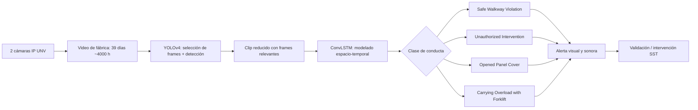

# Unsafe-Net – propuesta del nuevo proyecto

- **Fuente:** `NewBit_Top3_ComputerVision_SeguridadIndustrial.pdf`, página 3 (ficha del puesto #1 del "Top 3 investigaciones"), más las páginas 2, 6 y 7 en lo que se refiere a Unsafe-Net.
- **Semana:** 4 (05–11/10/2026) · **Estado:** el equipo decidió hacer **Unsafe-Net**. Los otros dos trabajos del PDF (Visual Relationship, Dual-Model Steel) quedan fuera de este documento.
- **Alcance de este archivo:** resumen fiel del trabajo y análisis. Lo que sea decisión de diseño del proyecto está marcado como **propuesta** y no viene del PDF.
- **Aviso:** este MD resume lo que dice el PDF; no se leyó el artículo original. Las cifras son las que el PDF atribuye al artículo.

## Ficha del trabajo

| Campo | Contenido |
|---|---|
| Título | **Unsafe-Net**: YOLO v4 y ConvLSTM para detección en tiempo real de comportamientos inseguros en una fábrica |
| Autores | Oğuzhan Önal; Emre Dandıl |
| Artículo | *Unsafe-Net: YOLO v4 and ConvLSTM based computer vision system for real-time detection of unsafe behaviours in workplace* |
| Revista | *Multimedia Tools and Applications* · publicado online 2024 · volumen 84 (2025) |
| DOI | 10.1007/s11042-024-19276-8 |
| Dataset | 39 días de video, ~4,000 horas, 2 cámaras IP UNV, una fábrica real en Turquía |
| Núcleo técnico | YOLOv4 filtra los frames relevantes; ConvLSTM clasifica la conducta con información espacial y temporal |
| Salida | Clasificación de la conducta insegura + alerta visual y sonora en la planta |

## Las cuatro conductas inseguras (clases)
1. **Safe Walkway Violation**: salirse de la zona peatonal segura.
2. **Unauthorized Intervention**: intervención no autorizada.
3. **Opened Panel Cover**: panel abierto.
4. **Carrying Overload with Forklift**: sobrecarga al transportar con montacargas.

*(Nombres en inglés tal como los lista el PDF; las descripciones en español son una interpretación del nombre, no una definición del artículo.)*

## Por qué el PDF lo pone en el puesto #1
- **No trabaja sobre una foto aislada:** entiende una secuencia de video y, por tanto, una acción.
- Se instaló como **piloto en una fábrica real**, con validación de un experto en seguridad ocupacional.
- Reporta **95.81 % de accuracy promedio** para las cuatro clases y **0.14 s** de reconocimiento de acción en el conjunto de prueba.
- En el periodo reportado, las acciones inseguras registradas **bajaron de 518 a 134 (~75 %)** tras instalar el sistema. El PDF aclara que **el artículo lo presenta como evidencia de impacto del piloto**.

## Flujo del sistema (reconstrucción conceptual)
El PDF aclara que los diagramas son **reconstrucciones propias, no figuras del artículo**.

**Lectura del flujo:** YOLOv4 hace de filtro: descarta frames sin interés y deja un clip corto; el ConvLSTM mira ese clip como secuencia y decide qué conducta ocurre. Si es una de las cuatro, se activa la alerta y un humano de SST valida o interviene.

## Limitaciones que reconoce el PDF
- El dataset sale de **un solo lugar**, con **solo dos ángulos de cámara** y **cuatro clases**.
- El propio estudio reconoce **falsos positivos** y la necesidad de ampliar la variedad de escenarios.
- Lección que extrae el PDF para NewBit: **temporalidad + contexto valen más que un detector de EPP aislado**; hay que **confirmar una situación durante una ventana temporal**, no alertar por un frame.

## Análisis

### Qué cambia respecto al proyecto anterior (VIGIA/NewBit)
| | Proyecto anterior (VIGIA) | Unsafe-Net |
|---|---|---|
| Qué se detecta | Objetos: persona, casco, chaleco, zona | **Conductas** a lo largo del tiempo |
| Modelo | YOLO + tracking + reglas | YOLO como filtro + **ConvLSTM** que clasifica secuencias |
| Etiquetado | Cajas por imagen | **Clips de video etiquetados por acción** |
| Evento | Regla geométrica (en zona sin casco ≥ N s) | Clase predicha por el modelo sobre un clip |
| Dato clave | Imágenes con cajas | Mucho video con acciones etiquetadas |

### Riesgos y puntos críticos (míos, a validar)
1. **Datos:** el estudio usó ~4,000 horas de video de una fábrica real. Para este proyecto hay que decidir de dónde saldrá el video (planta real con autorización, dataset público o grabaciones propias). Es el mayor riesgo y condiciona qué conductas se pueden elegir.
2. **Etiquetado de acciones:** etiquetar clips es más costoso que etiquetar cajas, y las conductas son específicas de una planta (pasillo seguro, panel, montacargas).
3. **Reproducibilidad:** el PDF no da detalles de implementación (arquitectura exacta del ConvLSTM, hiperparámetros, criterio de selección de frames). Habrá que reconstruirlos o usar valores propios; no se pueden presentar como los del artículo.
4. **Cifras del artículo:** 95.81 %, 0.14 s y la baja 518 → 134 son del estudio y de su contexto. **No son una promesa para nuestro proyecto** y la reducción de acciones es un resultado de un piloto concreto; no debe usarse en la Justificación como beneficio propio sin evidencia (el docente lo exige).
5. **Falsos positivos:** reconocidos por el propio artículo; conviene combinar el modelo con persistencia temporal y deduplicación.

### Qué se puede reutilizar del trabajo anterior (propuesta)
- La idea de **evento único con evidencia, cooldown y deduplicación**.
- La cadena **captura → detección → tracking → alerta → dashboard** como esqueleto, cambiando el bloque de "reglas" por "clasificador temporal".
- Los documentos del curso ya escritos (Acta, Roles) sirven de plantilla para rehacer los del nuevo proyecto.

### Decisiones abiertas (a definir con el equipo y el docente)
1. **¿Cuáles de las 4 conductas** se implementan (todas, o 1–2 para que sea viable en un semestre)?
2. **Fuente del video:** ¿hay acceso a una planta real o se usarán datos públicos/propios?
3. **Alcance exacto:** ¿replicar Unsafe-Net con el mismo diseño, o una versión propia (por ejemplo, otro detector o clases distintas)?
4. **Entorno:** ¿dónde se entrena el ConvLSTM (GPU local o en la nube)?
5. **Entregables del curso:** el Acta, los Roles, la Justificación y las Épicas se rehacen para este proyecto.
6. **Nombre del proyecto y del equipo Scrum** (el curso asume 1 PO + 1 SM + 3 developers).
