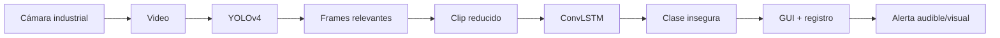

# 01 — Scope, taxonomía y definición del problema

## 1. Qué es Unsafe-Net

Unsafe-Net es un sistema híbrido de visión computacional para reconocer en video **cuatro clases de comportamiento inseguro** observadas en una fábrica real.

Combina:

- detección visual con YOLOv4;
- reducción/selección temporal del video;
- clasificación espacio-temporal con ConvLSTM;
- interfaz de monitoreo;
- registro de eventos;
- alerta física audible y visual.

## 2. Qué NO es

Unsafe-Net **no es**:

- un sistema general que entiende cualquier riesgo industrial;
- un detector universal de accidentes;
- un simple detector de EPP;
- un modelo de anomalías sin clases predefinidas;
- un sistema de reconocimiento facial;
- una arquitectura entrenada para múltiples fábricas;
- una prueba de que se reducen accidentes en 75%.

El sistema original reconoce un conjunto **cerrado y específico** de conductas definidas con expertos de la fábrica.

## 3. Taxonomía académica

```text
Artificial Intelligence
└── Machine Learning
    └── Deep Learning
        └── Computer Vision
            ├── Object Detection
            │   └── YOLOv4
            └── Video Understanding / Action Recognition
                └── ConvLSTM
```

### Dominio aplicado

```text
Occupational Health & Safety
└── Industrial / Manufacturing Safety
    └── Automated unsafe-behaviour detection
        └── Surveillance video analytics
```

## 4. Problema científico/técnico

Un detector de objetos puede responder:

> “¿Qué objetos aparecen en este frame?”

Pero un comportamiento requiere responder:

> “¿Qué está ocurriendo a lo largo de una secuencia?”

La tesis de Unsafe-Net es que el reconocimiento de acciones industriales mejora cuando primero se eliminan frames que no contribuyen a la conducta y luego se procesa la secuencia reducida con un modelo temporal.

## 5. Problema operativo

En un entorno industrial, revisar video humano de forma continua es costoso y difícil de sostener. Unsafe-Net busca detectar eventos concretos y generar una respuesta inmediata.

Su loop operativo es:



## 6. Unidad real de predicción

La unidad final de decisión no es un frame individual, sino un **fragmento temporal** que representa una acción.

Esto es crucial para una réplica: si el proyecto termina siendo solo “detecto una caja en una imagen”, ya no replica la idea principal del paper.

## 7. Clases inseguras finales

Las cuatro conductas que llegan a ConvLSTM son:

1. Safe Walkway Violation
2. Unauthorized Intervention
3. Opened Panel Cover
4. Carrying Overload with Forklift

Las clases seguras se usan en la construcción del dataset y en la etapa de filtrado/detección, pero la clasificación temporal final del paper se centra en las cuatro clases inseguras.

## 8. Pregunta de réplica recomendada

Para un curso, una pregunta experimental fiel sería:

> **¿La selección de frames relevantes antes del modelo temporal mejora la clasificación y reduce el tiempo de procesamiento frente a aplicar ConvLSTM directamente sobre los clips?**

Esa pregunta reproduce el núcleo del experimento sin requerir copiar toda la infraestructura industrial.
