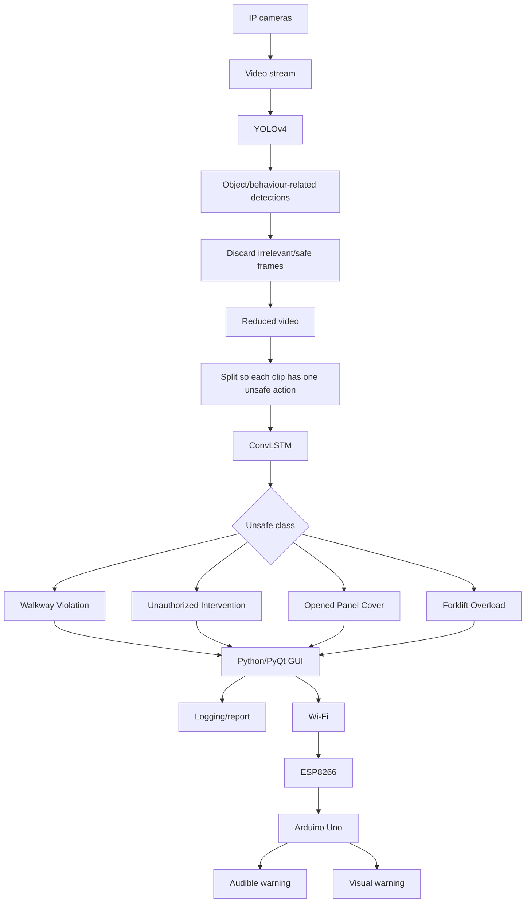

# 03 — Arquitectura original de Unsafe-Net

## 1. Arquitectura completa

Unsafe-Net tiene dos capas principales de inteligencia y una capa operativa.



## 2. Etapa A — adquisición

Fuente:
- cámaras IP de seguridad ya instaladas;
- dos ángulos;
- video Full HD;
- 24 FPS;
- H.264.

El paper no construye la investigación sobre un escenario de laboratorio sintético: parte de vigilancia industrial real.

## 3. Etapa B — YOLOv4

YOLOv4 tiene dos roles:

1. detectar objetos/patrones asociados a las clases;
2. usar esas detecciones como mecanismo de selección de frames.

El segundo rol es el más importante dentro de Unsafe-Net.

## 4. Etapa C — reducción temporal

El sistema elimina:

- frames seguros;
- frames irrelevantes;
- partes que no contienen una acción insegura de interés.

Después forma clips menores.

Ejemplo publicado:

- video inicial: 3.5 s / 105 frames;
- después de YOLOv4: 40 frames / 1.33 s;
- el material contiene tres acciones;
- se divide en tres fragmentos para que cada clip final represente una sola acción.

## 5. Etapa D — ConvLSTM

ConvLSTM recibe la secuencia reducida y clasifica entre las cuatro conductas inseguras.

La razón arquitectónica es combinar:

- estructura espacial de los frames;
- dependencia temporal entre frames.

## 6. Etapa E — software de monitoreo

Los autores desarrollaron una GUI en:

- Python;
- PyQt Designer.

La interfaz permite:
- arrancar/detener el sistema;
- visualizar actividades inseguras;
- consultar reportes de texto;
- operar el sistema de alertas.

## 7. Etapa F — alerta física

Cuando se detecta una conducta insegura:

```text
software
  → Wi-Fi
  → ESP8266
  → Arduino Uno
  → señal visual + señal sonora
```

Además:
- se registra el evento;
- se genera reporte automático.

## 8. Qué define a Unsafe-Net

No es cualquiera de los módulos por separado.

Su identidad está en la cadena:

> **percepción espacial → reducción temporal → comprensión temporal → acción operativa**

Una réplica educativa que conserve esa cadena seguirá siendo conceptualmente fiel aunque reduzca cantidad de datos, hardware o clases.
