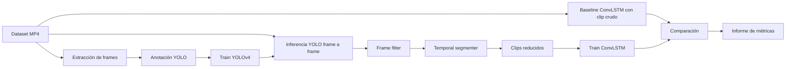

# 10 — Plan de réplica educativa a pequeña escala

## 1. Objetivo

Construir una versión reducida que demuestre la misma hipótesis central:

> **filtrar secuencias visuales antes de la clasificación temporal puede reducir costo y mejorar la clasificación de comportamientos.**

No buscamos reproducir 4,000 horas de CCTV ni un despliegue industrial completo.

## 2. Tres niveles posibles

### Nivel A — réplica mínima conceptual

**Costo bajo.**

- usar videos oficiales;
- seleccionar 2 conductas inseguras;
- generar dos conjuntos:
  - clips crudos;
  - clips reducidos;
- entrenar ConvLSTM en ambos;
- comparar accuracy + tiempo.

Ventaja:
- demuestra la tesis central.

Desventaja:
- no reconstruye YOLO.

### Nivel B — réplica pequeña fiel — RECOMENDADA

- 2–4 clases inseguras;
- extraer una muestra de frames;
- reanotar con LabelImg;
- entrenar YOLOv4;
- usar YOLO para frame filtering;
- segmentar clips;
- entrenar ConvLSTM;
- comparar baseline vs pipeline híbrido;
- dashboard/GUI simple;
- alerta simulada.

Esta es la mejor relación fidelidad/esfuerzo.

### Nivel C — réplica casi completa

- 8 clases para detección;
- ~2,262+ frames anotados;
- 4 clases inseguras en ConvLSTM;
- interfaz;
- hardware de alerta;
- set completo;
- métricas equivalentes;
- reproducción del piloto con videos o escenario controlado.

Es más costosa y no parece necesaria para un curso.

## 3. Alcance recomendado

### Clases

Ideal:
las cuatro inseguras.

Si el tiempo es corto:
- Safe Walkway Violation
- Opened Panel Cover

Razón:
son visualmente distintas y permiten evaluar temporalidad.

### Dataset

Usar:
- split oficial train/test cuando sea posible;
- subset estratificado para entrenamiento rápido.

No crear un random split nuevo si no hay necesidad.

## 4. Pipeline de réplica



## 5. Experimento mínimo

### H0

La reducción previa no mejora rendimiento temporal ni clasificación.

### H1

La reducción previa:
- reduce duración efectiva;
- reduce tiempo de inferencia;
- mantiene o mejora clasificación.

## 6. Componentes obligatorios

1. Dataset manager
2. Frame extractor
3. Annotation dataset
4. YOLO training/inference
5. Frame selector
6. Temporal segmenter
7. ConvLSTM trainer
8. Evaluator
9. Event/report output
10. Demo UI

## 7. Componentes opcionales

- Arduino;
- ESP8266;
- buzzer;
- LED;
- stream RTSP real;
- dashboard web;
- almacenamiento de eventos.

## 8. Regla de fidelidad

Toda diferencia con el paper debe registrarse.

Ejemplo:

```yaml
component: detector
original: YOLOv4
replica: YOLOv4
status: faithful
```

o:

```yaml
component: warning hardware
original: ESP8266 + Arduino Uno
replica: browser notification
status: adapted
reason: educational scope
```

## 9. No modernizar sin declarar

Usar YOLOv8, YOLO11, VLMs o Transformers puede ser interesante, pero ya sería una **variante moderna**, no la réplica base.

Primero:
- reproducir idea original.

Luego:
- opcionalmente comparar una arquitectura moderna.

## 10. Entregable final sugerido

```text
UnsafeNet-Edu/
├── data/
├── annotations/
├── detector/
├── temporal/
├── pipeline/
├── evaluation/
├── app/
├── reports/
├── docs/
└── README.md
```

La demo debe permitir:

1. seleccionar un MP4;
2. ejecutar pipeline;
3. mostrar clase detectada;
4. mostrar clip reducido;
5. comparar tiempos;
6. registrar resultado.
